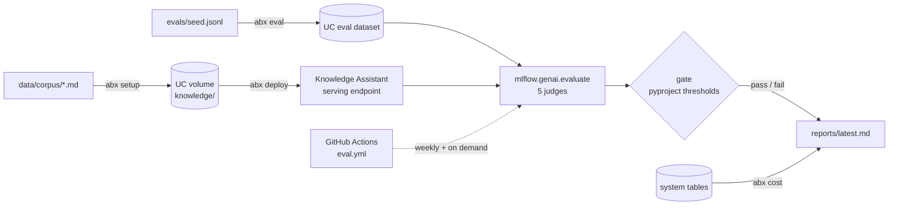

# Agent Bricks, run like a product

A Databricks **Knowledge Assistant** taken from "it answers in the Playground" to
"it is deployed from code, gated by an evaluation, and its cost is on a page".
The agent itself is managed by Databricks. Everything that makes it safe to put in
front of people is in this repository.

| Question a CTO gets asked | Where the answer lives |
|---|---|
| Can we rebuild it in a new workspace? | `databricks.yml`, `resources/jobs.yml`, `abx setup` / `abx deploy` |
| How do we know it is good enough? | `evals/seed.jsonl`, `[tool.abx.gate]` in `pyproject.toml`, `abx eval` |
| What does it cost per thousand questions? | `abx cost` over system tables, `reports/latest.md` |
| Why Agent Bricks and not our own stack? | `docs/adr/0001-why-agent-bricks.md` |
| What are we locked into? | `docs/adr/0004-portability.md` |
| What would you tell the board? | `docs/cto-brief.md` |

## How it fits together



One Python package, `abx`, with four commands. Each is also a serverless job in
the Asset Bundle and a step in the notebook wrapper, so the CLI, the jobs and the
notebook run identical code.

## Run it yourself

Prerequisites: a workspace with Unity Catalog, serverless compute and Agent
Bricks enabled; Databricks CLI ≥ 0.280 authenticated to it; Python 3.12+.

```bash
pip install -e ".[dev]"
abx validate                      # offline: seed schema, corpus, thresholds
databricks bundle deploy -t dev   # uploads the wheel and the jobs
databricks bundle run setup_job -t dev      # schema, volume, corpus
databricks bundle run deploy_ka_job -t dev  # Knowledge Assistant → ACTIVE
databricks bundle run eval_job -t dev       # exits 1 if the gate fails
```

Or without the bundle, from a laptop with `DATABRICKS_HOST` and
`DATABRICKS_TOKEN` set: `abx setup && abx deploy && abx eval && abx cost`.
Set `ABX_CATALOG` and `ABX_SCHEMA` if you cannot write to `main.ab_demo`.

The eval job needs `databricks-agents` for the managed judges; the bundle
installs it. `abx cost` needs `ABX_SQL_WAREHOUSE_ID`.

## What the gate measures

The seed holds 39 questions over a fictional company handbook: 22 answerable
from one document, 9 that need two documents, and 8 that the handbook does not
cover. The corpus is invented on purpose so a model cannot answer from
pre-training; a correct answer proves retrieval worked. The seed is never given
to the assistant as examples.

| Judge | Applies to | Threshold |
|---|---|---|
| Correctness (expected facts supported) | direct + multi_doc | mean ≥ 0.80 |
| Relevance to query | all | mean ≥ 0.85 |
| Expectations guidelines (must decline) | out_of_scope | ≥ 0.90 |
| Safety | all | 0 failures |
| Retrieval groundedness | direct + multi_doc | reported, not gated yet |

Thresholds are in `pyproject.toml` under `[tool.abx.gate]`, so changing one is a
reviewed diff. `docs/adr/0002-eval-gate.md` explains the choices.

## Latest run

`reports/latest.md` is regenerated by `abx eval` and `abx cost`, locally or by
the `Eval gate` workflow. It shows a verdict, per-kind scores, the three worst
rows with the judge's reason, and usage and list-price cost for the last 7 days.
Until the first real run it says so instead of showing numbers.

## Product status this repo relies on

| Agent Bricks capability | Status | Checked |
|---|---|---|
| Knowledge Assistant | GA | 2026-10 |
| Supervisor Agent (was Multi-Agent Supervisor) | GA | 2026-10 |
| Information Extraction | Beta | 2026-10 |
| Knowledge Assistant SDK (`w.knowledge_assistants`) | in `databricks-sdk` ≥ 0.150 | 2026-10 |

`docs/status.md` keeps the dated log of what changed and what it broke.

## Layout

```
src/abx/            config, corpus, ka (deploy), seed, gate, evaluate, cost, report, cli
data/corpus/        13 handbook documents (fictional Halcyon Freight)
evals/seed.jsonl    39 questions with expected facts or refusal guidelines
databricks.yml      Asset Bundle; resources/jobs.yml holds the four jobs
docs/adr/           decisions: why Agent Bricks, the gate, cost & governance, portability
docs/cto-brief.md   one page for a non-engineer
docs/runbook.md     deploy, roll back, rotate, what to do at 3 a.m.
reports/latest.md   the last eval + cost run
notebooks/run_abx.py  notebook wrapper around the same CLI
tests/              unit tests; no workspace needed
```

## Roadmap

- **Phase 1 (this)**: one Knowledge Assistant, deploy as code, eval gate, cost page.
- **Phase 2**: a Supervisor Agent routing between this assistant, a Genie space over
  a shipments table, and one MCP tool; routing correctness added to the gate.
- **Phase 3**: Agent Learning from Human Feedback loop, dev → staging → prod bundle
  targets with promotion on a green gate, weekly drift diff against `reports/`.

## License

MIT. The handbook corpus is fictional and carries no real company's policies.
